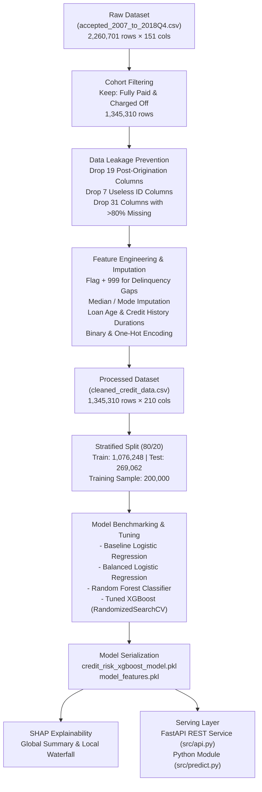
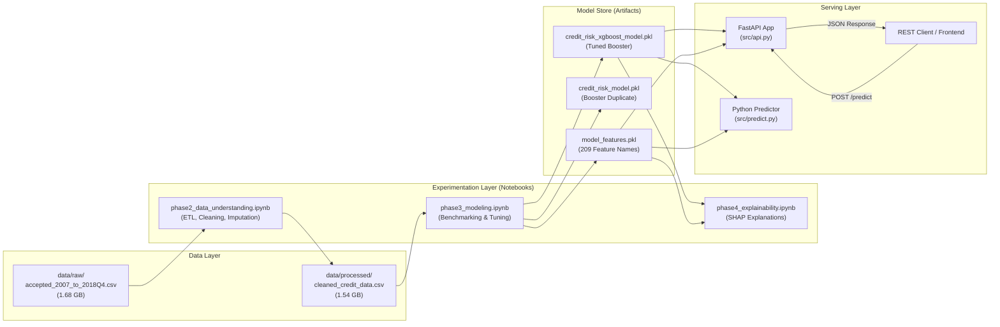

# AI Credit Risk Prediction Model

An end-to-end machine learning system for credit default risk assessment built on LendingClub loan records. The project implements data leakage prevention, class imbalance handling, tree-based gradient boosting (XGBoost), model explainability using SHAP, and a RESTful prediction API powered by FastAPI.

---

## Project Overview

Credit risk evaluation is one of the most critical decision-making processes in banking and peer-to-peer lending. When a financial institution grants a loan, it must determine whether the borrower is likely to repay the loan in full or default. 

This repository contains an end-to-end data science and machine learning pipeline developed to classify credit applications as either **Fully Paid** (non-default, label `0`) or **Charged Off** (default, label `1`). The project covers every stage of the lifecycle:

1. **Exploratory Data Analysis & Leakage Auditing**: Filtering valid loan cohorts from 2.26+ million raw loan records, stripping 19 post-origination leakage features, and removing high-missingness columns (>80%).
2. **Feature Engineering & Imputation**: Domain-aware missing-value handling, median/mode imputation, datetime duration calculation, binary feature encoding, and one-hot encoding across categorical attributes (expanding the feature space to 209 predictive variables).
3. **Model Development & Benchmarking**: Evaluating Logistic Regression (baseline and class-weighted), Random Forest, and XGBoost classifiers on a stratified test partition of 269,062 records.
4. **Hyperparameter Tuning**: Optimizing XGBoost hyperparameters via 3-fold cross-validated RandomizedSearchCV, achieving a **0.9697 ROC-AUC** and **93.26% test accuracy**.
5. **Model Interpretability**: Generating global and local explanations using SHAP (SHapley Additive exPlanations) TreeExplainer to interpret feature influence on risk scores.
6. **Inference & Serving**: Providing both a programmatic Python interface (`src/predict.py`) and a production-ready HTTP REST API (`src/api.py`) built with FastAPI and Pydantic.

---

## Problem Statement

Financial lenders face an asymmetrical cost structure:
- **False Negatives (Classifying a defaulting borrower as creditworthy)**: Results in direct loss of unpaid principal and accrued interest, which can severely impair lender solvency.
- **False Positives (Classifying a creditworthy borrower as high-risk)**: Leads to rejected loan applications, forfeited interest revenue, and customer attrition.

Standard credit datasets often contain severe pitfalls:
- **Class Imbalance**: Default cases constitute approximately 20% of closed loans, meaning a naive model predicting 100% repayment achieves 80% accuracy while failing to detect defaults.
- **Data Leakage**: Columns recorded *after* loan origination (e.g., collection recoveries, payment plan dates, late fees) artificially inflate model performance in test environments while rendering the model ineffective for upfront underwriting.
- **High Dimensionality & Sparse Missingness**: Lending datasets contain a mix of credit bureau records, employment timelines, inquiry tallies, and varying missingness structures that require careful imputation rather than blanket row deletion.

---

## Proposed Solution

To solve these challenges, this project implements a structured, multi-phase machine learning workflow:



---

## Key Features

- **Large-Scale Data Pipeline**: Capable of processing 2.26+ million loan records and outputting a clean, numeric dataset of 1.34+ million rows.
- **Targeted Leakage Elimination**: Specifically isolates and drops 19 columns containing post-loan-origination settlement, collection, and payment information.
- **Missing Value Handling Strategy**:
  - Delinquency and inquiry columns use indicator flags (`_missing_flag`) combined with out-of-range sentinel values (`999`) to preserve signal on borrowers who never had delinquencies.
  - Remaining continuous metrics are imputed with training medians; categorical fields are imputed with training modes.
- **Date Feature Extraction**: Converts raw date strings into elapsed durations (`loan_age_months`, `credit_history_months`, `months_since_last_credit_pull`) relative to the dataset reference date (`2018-12-01`).
- **Comprehensive Model Evaluation**: Compares linear baselines, ensemble bagging (Random Forest), and gradient boosting (XGBoost) using Accuracy, Precision, Recall, F1-Score, Confusion Matrices, and ROC-AUC.
- **Threshold Optimization**: Demonstrates recall-precision trade-offs across decision thresholds (`0.30` to `0.50`), highlighting how tuning from `0.50` to `0.40` increases default detection recall from 86.2% to 90.3% in weighted logistic regression.
- **Explainable AI (XAI)**: Implements SHAP TreeExplainer to visualize global feature importance and individual applicant risk attribution waterfall plots.
- **API Serving**: Exposes a lightweight FastAPI endpoint validating requests with Pydantic and returning discrete predictions and default probabilities.

---

## How It Works (Step-by-Step)

### Phase 2: Data Understanding, Cleaning, and Feature Engineering
*File: `notebooks/phase2_data_understanding.ipynb`*

1. **Ingestion & Outcome Isolation**:
   - The raw LendingClub CSV (`accepted_2007_to_2018Q4.csv`) containing 2,260,701 rows and 151 columns is loaded.
   - Ongoing loans (`Current`, `In Grace Period`, `Late (16-30 days)`, `Late (31-120 days)`) are removed because their final repayment outcome is undetermined.
   - Only finalized loans (`Fully Paid`: 1,076,751 and `Charged Off`: 268,559) are retained, yielding 1,345,310 records.
   - The binary target `default` is created: `1` for `Charged Off`, `0` for `Fully Paid`.
2. **Leakage & Administrative Drop**:
   - 19 columns tracking post-origination behavior are removed: `out_prncp`, `out_prncp_inv`, `total_pymnt`, `total_pymnt_inv`, `total_rec_prncp`, `total_rec_int`, `total_rec_late_fee`, `recoveries`, `collection_recovery_fee`, `last_pymnt_d`, `last_pymnt_amnt`, `payment_plan_start_date`, `debt_settlement_flag`, `debt_settlement_flag_date`, `settlement_status`, `settlement_date`, `settlement_amount`, `settlement_percentage`, `settlement_term`.
   - 7 identifier/text columns with no predictive utility are dropped: `id`, `member_id`, `url`, `desc`, `title`, `zip_code`, `emp_title`.
3. **Missingness Thresholding & Imputation**:
   - 31 columns exceeding an 80% null threshold are dropped.
   - For delinquency features (`mths_since_recent_bc_dlq`, `mths_since_last_major_derog`, `mths_since_recent_revol_delinq`, `mths_since_last_delinq`), null values are flagged (`_missing_flag = 1`) and replaced with `999`.
   - Remaining numerical features are imputed using column medians; categorical features are imputed using column modes.
4. **Encoding & Date Transformations**:
   - Date fields (`issue_d`, `earliest_cr_line`, `last_credit_pull_d`) are converted to elapsed months relative to December 2018.
   - Binary categories (`term`, `initial_list_status`, `application_type`, `disbursement_method`) are mapped to integer flags `0` and `1`.
   - Multiclass categories (`grade`, `sub_grade`, `emp_length`, `home_ownership`, `verification_status`, `purpose`, `addr_state`) are one-hot encoded using `pd.get_dummies(drop_first=True)`.
5. **Persistence**:
   - The final dataset of 1,345,310 rows and 210 columns is saved to `data/processed/cleaned_credit_data.csv`.

### Phase 3: Model Training, Evaluation, and Serialization
*File: `notebooks/phase3_modeling.ipynb`*

1. **Stratified Partitioning**:
   - The processed dataset is partitioned into 80% training (1,076,248 rows) and 20% test (269,062 rows), stratified by `default`.
   - For rapid iterative experimentation of complex estimators, a stratified sample of 200,000 rows (`X_train_sample`) is extracted from the training set.
2. **Estimator Evaluation**:
   - **Logistic Regression (Standard)**: Trained on standardized features (`StandardScaler`). Serves as the linear baseline.
   - **Logistic Regression (Class-Weighted)**: Configured with `class_weight="balanced"` to counteract the 80:20 class imbalance, followed by empirical decision threshold analysis.
   - **Random Forest**: Configured with 100 trees and `max_depth=10`.
   - **XGBoost (Baseline)**: Configured with 200 estimators, learning rate `0.1`, `max_depth=6`.
3. **Hyperparameter Optimization**:
   - A `RandomizedSearchCV` across 20 parameter iterations with 3-fold cross-validation evaluates tree depths (`4, 6, 8`), learning rates (`0.01, 0.05, 0.1`), subsampling ratios, and tree counts (`200, 300, 400`).
   - The optimal estimator is evaluated against the held-out 269,062 test records.
4. **Model Artifact Export**:
   - Best XGBoost model serialized to `models/credit_risk_xgboost_model.pkl` and `models/credit_risk_model.pkl`.
   - 209-element feature list serialized to `models/model_features.pkl`.

### Phase 4: Model Explainability (SHAP)
*File: `notebooks/phase4_explainability.ipynb`*

1. Loads the serialized XGBoost model and aligned feature list.
2. Initializes a `shap.TreeExplainer` on the gradient-boosted decision trees.
3. Computes SHAP values across test records.
4. Generates summary plots (beeswarm and bar) and applicant-level waterfall explanation plots.

### Phase 5: Production Serving
*Files: `src/api.py`, `src/predict.py`*

1. Reusable Python module `src/predict.py` provides the function `predict_default(input_data: dict)`.
2. FastAPI application `src/api.py` exposes REST endpoints over HTTP, deserializing incoming loan application payloads via Pydantic and returning real-time default predictions and probabilities.

---

## System Architecture

The following diagram illustrates how raw data flows through preprocessing, training, model persistence, and deployment:



---

## Technology Stack

All libraries, tools, and versions verified directly from project dependency files (`.dist-info`):

| Category | Component / Tool | Version | Purpose |
|---|---|---|---|
| **Programming Language** | Python | 3.11 / 3.13 / 3.14 compatible | Core runtime for notebooks, scripts, and API |
| **Machine Learning** | XGBoost | 3.2.0 | Primary gradient-boosted decision tree algorithm |
| **Machine Learning** | Scikit-Learn | 1.8.0 | Data splitting, scaling, baseline models, tuning (`RandomizedSearchCV`) |
| **Data Processing** | Pandas | 3.0.1 | Tabular data manipulation, encoding, and aggregation |
| **Numerical Computing** | NumPy | 2.4.2 | Matrix and array manipulations |
| **Scientific Computing** | SciPy | 1.17.1 | Statistical distributions for hyperparameter search |
| **Model Explainability** | SHAP | 0.50.0 | Game-theoretic model explainability (TreeExplainer) |
| **Model Serialization** | Joblib | 1.5.3 | Serializing and deserializing estimators and feature lists |
| **API Framework** | FastAPI | 0.134.0 | Asynchronous HTTP REST API framework |
| **Data Validation** | Pydantic | 2.12.5 | Request schema validation and data parsing |
| **ASGI Web Server** | Uvicorn | 0.41.0 | High-performance ASGI HTTP server for FastAPI |
| **Data Visualization** | Matplotlib | 3.10.8 | Plotting feature importances and ROC curves |
| **Data Visualization** | Seaborn | 0.13.2 | Statistical charts and correlation plots |
| **Interactive Computing**| JupyterLab / Notebook | 4.5.5 / 7.5.4 | Interactive execution of experimental phases |

---

## Project Structure

```
AI_Credit_Risk_Prediction_Model/
│
├── data/
│   ├── raw/
│   │   └── accepted_2007_to_2018Q4.csv       # Raw LendingClub dataset (2.26M rows, 151 cols, ~1.68 GB)
│   └── processed/
│       └── cleaned_credit_data.csv           # Cleaned, encoded dataset (1.34M rows, 210 cols, ~1.54 GB)
│
├── models/
│   ├── credit_risk_xgboost_model.pkl         # Serialized tuned XGBoost model (~1.7 MB)
│   ├── credit_risk_model.pkl                 # Duplicate export of tuned XGBoost model (~1.7 MB)
│   └── model_features.pkl                    # Pickled list of 209 feature column names (~4.3 KB)
│
├── notebooks/
│   ├── phase2_data_understanding.ipynb       # EDA, data leakage mitigation, imputation & encoding
│   ├── phase3_modeling.ipynb                 # Train/test split, baseline models, tuning & evaluation
│   └── phase4_explainability.ipynb           # Model interpretability with SHAP TreeExplainer
│
├── src/
│   ├── __init__.py                           # Package marker (omitted if implicit namespace)
│   ├── api.py                                # FastAPI REST service exposing GET / and POST /predict
│   └── predict.py                            # Standalone Python inference function predict_default()
│
├── .gitignore                                # Git ignore rules for data, models, cache, and virtualenvs
└── README.md                                 # Comprehensive project documentation
```

---

## Technical Implementation

### 1. Data Leakage Prevention
In loan risk modeling, data leakage occurs when attributes updated during the loan repayment cycle are used as inputs for an origination-time model. In `phase2_data_understanding.ipynb`, 19 features were systematically identified and removed:
- **Settlement metrics**: `debt_settlement_flag`, `debt_settlement_flag_date`, `settlement_status`, `settlement_date`, `settlement_amount`, `settlement_percentage`, `settlement_term`.
- **Collection & Recovery fields**: `recoveries`, `collection_recovery_fee`, `payment_plan_start_date`.
- **Post-origination payment tracking**: `out_prncp`, `out_prncp_inv`, `total_pymnt`, `total_pymnt_inv`, `total_rec_prncp`, `total_rec_int`, `total_rec_late_fee`, `last_pymnt_d`, `last_pymnt_amnt`.

### 2. Feature Encoding Strategy
The dataset's 209 features consist of:
- **Continuous Financial Metrics**: `loan_amnt`, `installment`, `annual_inc`, `dti`, `revol_bal`, `revol_util`, `tot_cur_bal`, `avg_cur_bal`, etc.
- **Credit Bureau Counts & Inquiries**: `delinq_2yrs`, `inq_last_6mths`, `open_acc`, `pub_rec`, `total_acc`, `num_bc_tl`, `tax_liens`, etc.
- **Engineered Duration Indicators**: `loan_age_months`, `credit_history_months`, `months_since_last_credit_pull`.
- **Missingness Flags**: `mths_since_recent_bc_dlq_missing_flag`, `mths_since_last_major_derog_missing_flag`, `mths_since_recent_revol_delinq_missing_flag`, `mths_since_last_delinq_missing_flag`, `mths_since_rcnt_il_missing_flag`.
- **Binary Mapped Features**: `term` (36m=0, 60m=1), `initial_list_status` (f=0, w=1), `application_type` (Individual=0, Joint App=1), `disbursement_method` (Cash=0, DirectPay=1).
- **One-Hot Encoded Dummies (120 columns)**:
  - Loan Grade (`grade_B` through `grade_G`) and Subgrade (`sub_grade_A2` through `sub_grade_G5`).
  - Employment Length (`emp_length_< 1 year` through `emp_length_10+ years`).
  - Home Ownership (`home_ownership_MORTGAGE`, `OWN`, `RENT`, `OTHER`, `NONE`).
  - Verification Status (`Source Verified`, `Verified`).
  - Loan Purpose (`credit_card`, `debt_consolidation`, `small_business`, etc.).
  - Borrower State (`addr_state_AL` through `addr_state_WY`).

### 3. Hyperparameter Tuning Specifications
The winning XGBoost model was selected via `RandomizedSearchCV` on a 200,000-sample training subset across the following search space:
- Search Parameters:
  - `n_estimators`: `[200, 300, 400]` (Optimal: `400`)
  - `max_depth`: `[4, 6, 8]` (Optimal: `6`)
  - `learning_rate`: `[0.01, 0.05, 0.1]` (Optimal: `0.05`)
  - `subsample`: `[0.7, 0.8, 0.9]` (Optimal: `0.7`)
  - `colsample_bytree`: `[0.7, 0.8, 0.9]` (Optimal: `0.7`)
  - `gamma`: `[0, 0.1, 0.2]` (Optimal: `0.2`)
- Optimization Metric: `roc_auc`
- Cross-Validation: 3-fold (`cv=3`, total 60 model fits)

---

## Installation & Setup

### Prerequisites
- Python 3.11, 3.13, or 3.14 (64-bit)
- Git
- At least 8 GB RAM (16 GB recommended for loading full processed CSV files into Pandas)
- ~6 GB free disk space (to store raw CSV, processed CSV, models, and virtual environment)

### 1. Clone the Repository
```bash
git clone https://github.com/KrishPatel-AI/AI_Credit_Risk_Prediction_Model.git
cd AI_Credit_Risk_Prediction_Model
```

### 2. Create and Activate a Virtual Environment
```bash
# On Windows (PowerShell)
python -m venv .venv
.\.venv\Scripts\Activate.ps1

# On Windows (Command Prompt)
python -m venv .venv
.\.venv\Scripts\activate.bat

# On Linux / macOS
python3 -m venv .venv
source .venv/bin/activate
```

### 3. Install Dependencies
Create a `requirements.txt` file or install the verified project packages directly:

```bash
pip install fastapi>=0.134.0 uvicorn>=0.41.0 pydantic>=2.12.0 pandas>=3.0.0 numpy>=2.4.0 scikit-learn>=1.8.0 xgboost>=3.2.0 shap>=0.50.0 joblib>=1.5.0 matplotlib>=3.10.0 seaborn>=0.13.0
```

For working with the Jupyter notebooks:
```bash
pip install jupyterlab ipykernel
```

---

## Environment Configuration

The application currently reads serialized models from relative local paths (`BASE_DIR / "models" / "credit_risk_xgboost_model.pkl"`). No secret keys, database credentials, or external API tokens are required.

If configuring custom host or port bindings for the API, you can define standard environment variables:

| Variable | Required | Default | Description |
|---|---|---|---|
| `PORT` | Optional | `8000` | Port for the Uvicorn web server |
| `HOST` | Optional | `127.0.0.1` | Host address for binding the web server |

---

## How to Run

### 1. Run the FastAPI Service
From the repository root:
```bash
uvicorn src.api:app --reload --host 127.0.0.1 --port 8000
```
The server will start at `http://127.0.0.1:8000`. 
Interactive Swagger API documentation will be available at:
`http://127.0.0.1:8000/docs`

### 2. Run Programmatic Inference via Python
You can call the standalone prediction function from any Python script:
```python
from src.predict import predict_default

sample_applicant = {
    "loan_amnt": 15000.0,
    "int_rate": 12.5,
    "annual_inc": 75000.0,
    "dti": 18.2
}

result = predict_default(sample_applicant)
print("Inference Result:", result)
```

### 3. Run the Jupyter Notebooks
Launch JupyterLab to inspect or re-execute the analysis:
```bash
jupyter lab
```
Open notebooks in sequence:
1. `notebooks/phase2_data_understanding.ipynb`
2. `notebooks/phase3_modeling.ipynb`
3. `notebooks/phase4_explainability.ipynb`

---

## API Documentation

### Base URL
`http://127.0.0.1:8000`

### Endpoints

#### 1. Health Check
- **Method**: `GET`
- **Path**: `/`
- **Description**: Returns operational status of the service.
- **Response**:
  ```json
  {
    "message": "Credit Risk Prediction API is running"
  }
  ```

#### 2. Credit Risk Prediction
- **Method**: `POST`
- **Path**: `/predict`
- **Headers**: `Content-Type: application/json`
- **Request Body**:
  | Field | Type | Description | Example |
  |---|---|---|---|
  | `loan_amnt` | `float` | Requested loan amount in USD | `10000.0` |
  | `int_rate` | `float` | Interest rate percentage | `11.5` |
  | `annual_inc` | `float` | Annual self-reported borrower income | `65000.0` |
  | `dti` | `float` | Debt-to-Income ratio | `15.4` |

- **Example Request Payload**:
  ```json
  {
    "loan_amnt": 10000.0,
    "int_rate": 11.5,
    "annual_inc": 65000.0,
    "dti": 15.4
  }
  ```

- **Response Body**:
  ```json
  {
    "prediction": 0,
    "default_probability": 0.0842103511095047
  }
  ```
  - `prediction`: Binary classification (`0` = Fully Paid / Low Risk, `1` = Default / High Risk).
  - `default_probability`: Estimated likelihood of default (float between `0.0` and `1.0`).

---

## Usage Instructions

### Calling the API with cURL
```bash
curl -X POST "http://127.0.0.1:8000/predict" \
     -H "Content-Type: application/json" \
     -d '{
       "loan_amnt": 12000.0,
       "int_rate": 14.5,
       "annual_inc": 52000.0,
       "dti": 22.4
     }'
```

### Calling the API with Python `requests`
```python
import requests

url = "http://127.0.0.1:8000/predict"
payload = {
    "loan_amnt": 12000.0,
    "int_rate": 14.5,
    "annual_inc": 52000.0,
    "dti": 22.4
}

response = requests.post(url, json=payload)
print(response.status_code)
print(response.json())
```

---

## Database & Data Management

The project uses file-based persistence for raw and processed datasets:

- **Raw Data Ingestion**:
  - File: `data/raw/accepted_2007_to_2018Q4.csv` (1,675,133,810 bytes).
  - Ingested with `low_memory=False` to manage heterogeneous column types.
- **Processed Data Storage**:
  - File: `data/processed/cleaned_credit_data.csv` (1,542,391,748 bytes).
  - Contains strictly numeric (float, int, bool) transformed data with no nulls.
- **Git Storage Policy**:
  - Large data files under `data/raw/*` and `data/processed/*`, as well as model binaries under `models/*.pkl`, are excluded from version control via `.gitignore`.

---

## Testing & Verification

While formal automated unit test suites (e.g., `pytest`) are not included in the repository, model correctness and inference functionality were verified through execution outputs in the notebooks and script test runs:

1. **Stratified Partition Verification**:
   - Class ratios confirmed to remain strictly identical (80.037% non-default, 19.963% default) across train (`1,076,248` records), test (`269,062` records), and sample (`200,000` records).
2. **Missing Value Audit**:
   - Final null check executed: `df.isnull().sum().sum() == 0` confirmed on the processed dataset.
3. **Inference Pipeline Checks**:
   - `models/credit_risk_xgboost_model.pkl` loaded in `phase3_modeling.ipynb` (Cell 42) and tested against a 5-record sample (`sample_data = X_test.iloc[:5]`), returning valid predictions `[0 0 0 0 0]`.
4. **SHAP Integration Verification**:
   - `phase4_explainability.ipynb` executed `shap.TreeExplainer(model).shap_values(X)` across the full dataset, confirming compatibility between the booster and SHAP visualizers.

---

## Actual Project Metrics

All metrics below are drawn directly from the executed cells in `notebooks/phase3_modeling.ipynb` evaluated against the independent test set of **269,062 records** (215,350 class `0` and 53,712 class `1`):

### 1. Overall Model Comparison (Cell 39)
| Model | Test Accuracy | Test ROC-AUC | Training Sample Size | Notes |
|---|---|---|---|---|
| **Logistic Regression (Baseline)** | 0.911 (91.11%) | 0.9502 | 200,000 | Standardized with `StandardScaler` |
| **Logistic Regression (Balanced)** | 0.880 (88.00%) | 0.9381 | 200,000 | `class_weight="balanced"`, threshold = 0.50 |
| **Random Forest** | 0.916 (91.57%) | 0.9513 | 200,000 | 100 trees, `max_depth=10` |
| **XGBoost (Default Baseline)** | 0.933 (93.30%) | 0.9696 | 200,000 | 200 trees, `max_depth=6`, `lr=0.1` |
| **Tuned XGBoost (Final Model)** | **0.933 (93.26%)** | **0.9697** | 200,000 | 400 trees, `max_depth=6`, `lr=0.05` |

### 2. Detailed Classification Reports on Test Set (269,062 loans)

#### Baseline Logistic Regression (Cell 10)
```
              precision    recall  f1-score   support
           0       0.94      0.95      0.95    215350
           1       0.80      0.74      0.77     53712

    accuracy                           0.91    269062
   macro avg       0.87      0.85      0.86    269062
weighted avg       0.91      0.91      0.91    269062

Confusion Matrix:
[[205645,   9705],
 [ 14219,  39493]]
```

#### Tuned XGBoost Classifier (Cells 32 & 38)
```
              precision    recall  f1-score   support
           0       0.95      0.96      0.96    215350
           1       0.85      0.81      0.83     53712

    accuracy                           0.93    269062
   macro avg       0.90      0.89      0.89    269062
weighted avg       0.93      0.93      0.93    269062

Confusion Matrix:
[[207762,   7588],
 [ 10431,  43281]]
```

### 3. Threshold Optimization (Balanced Logistic Regression, Cell 21)
| Threshold | Class 1 Recall (Default) | Class 1 Precision | True Positives | False Positives |
|---|---|---|---|---|
| `0.50` | 86.2% | 65.6% | 46,299 | 24,285 |
| `0.45` | 88.4% | 62.9% | 47,475 | 28,003 |
| **`0.40` (Selected)** | **90.3%** | **60.0%** | **48,524** | **32,412** |
| `0.35` | 92.1% | 56.5% | 49,450 | 38,057 |
| `0.30` | 93.9% | 52.8% | 50,443 | 45,049 |

### 4. Top 10 Most Important Features (XGBoost Gini Importance, Cell 44)
1. `last_fico_range_low`: **0.2526** (25.26%)
2. `last_fico_range_high`: **0.1291** (12.91%)
3. `mths_since_rcnt_il_missing_flag`: **0.0779** (7.79%)
4. `term`: **0.0348** (3.48%)
5. `months_since_last_credit_pull`: **0.0181** (1.81%)
6. `int_rate`: **0.0120** (1.20%)
7. `loan_age_months`: **0.0107** (1.07%)
8. `mths_since_rcnt_il`: **0.0105** (1.05%)
9. `funded_amnt_inv`: **0.0068** (0.68%)
10. `loan_amnt`: **0.0062** (0.62%)

---

## Current Implementation Status

| Component | Status | Verification Basis |
|---|---|---|
| **Raw Data Ingestion & Filtering** | Completed | Fully implemented and executed in `phase2_data_understanding.ipynb` |
| **Leakage Elimination & Imputation** | Completed | Verified in notebook; `cleaned_credit_data.csv` contains 0 null values |
| **Feature Engineering & Encodings** | Completed | 209 features generated and persisted in `model_features.pkl` |
| **Baseline Linear Models** | Completed | Scaled and class-weighted models trained and evaluated on 269K test rows |
| **Random Forest Baseline** | Completed | 100-estimator model trained and benchmarked |
| **XGBoost Hyperparameter Tuning** | Completed | RandomizedSearchCV (60 fits) completed; optimal booster serialized |
| **SHAP Interpretability** | Completed | TreeExplainer, summary, bar, and waterfall plots generated in Phase 4 |
| **FastAPI REST Service** | Completed | Implemented in `src/api.py` with GET `/` and POST `/predict` |
| **Python Inference Function** | Completed | Implemented in `src/predict.py` |
| **Automated Unit Tests** | Missing | No `tests/` directory or automated test runner currently implemented |
| **Containerization (Docker)** | Missing | No `Dockerfile` or `docker-compose.yml` present in repository |
| **CI/CD Pipeline** | Missing | No GitHub Actions or CI pipeline configured |

---

## Limitations & Known Issues

1. **Feature Sparsity in API Serving (`src/api.py`)**:
   - The FastAPI endpoint accepts only 4 input parameters (`loan_amnt`, `int_rate`, `annual_inc`, `dti`).
   - The remaining 205 features (including loan grade, subgrade, home ownership, employment length, credit inquiries, and FICO scores) are defaulted to `0`.
   - Because `last_fico_range_low` and `last_fico_range_high` account for over 38% of total feature importance, defaulting these values to `0` will distort default probability calculations.
2. **Column Name Sanitization & Feature Validation**:
   - In `notebooks/phase3_modeling.ipynb`, XGBoost was trained on feature column names sanitized with `re.sub(r"[^\w]", "_", col)` (e.g., converting `emp_length_< 1 year` to `emp_length___1_year`).
   - `models/model_features.pkl` was dumped before this sanitization step, preserving original column names with spaces and symbols.
   - While `src/api.py` suppresses booster validation by calling `model.predict(aligned_df, validate_features=False)`, `src/predict.py` does not pass `validate_features=False`, which can trigger a feature name mismatch warning or exception in strict XGBoost environments.
3. **Data Leakage Nuance on `last_fico_range`**:
   - While 19 post-origination columns were properly removed, `last_fico_range_low` and `last_fico_range_high` (recorded at the last credit bureau pull) were retained.
   - In actual production underwriting, only origination credit scores (`fico_range_low`, `fico_range_high`) are available. Retaining `last_fico_range` contributes significantly to the exceptionally high ROC-AUC (0.9697).
4. **Virtual Environment Portability**:
   - The committed `.venv/pyvenv.cfg` contains an absolute path reference to `C:\Users\krish\anaconda3\python.exe`. On systems where Anaconda is not located at that path, invoking `.\.venv\Scripts\python.exe` will fail until the virtual environment is recreated.

---

## Future Improvements

1. **API Schema Expansion**:
   - Expand the `LoanApplication` Pydantic model in `src/api.py` to accept all major underwriting variables (FICO score, employment duration, home ownership, loan purpose, and state) and apply consistent one-hot encoding dynamically.
2. **Strict Origination Pipeline**:
   - Train an alternative model version excluding `last_fico_range_low`, `last_fico_range_high`, and `months_since_last_credit_pull`, relying solely on origination-stage bureau variables (`fico_range_low`, `fico_range_high`, `earliest_cr_line`).
3. **Automated Unit & Integration Testing**:
   - Implement a `tests/` directory with `pytest` test suites verifying API request validation, model deserialization, feature alignment, and inference outputs.
4. **Containerization & Deployment**:
   - Add a multi-stage `Dockerfile` to containerize the FastAPI service and lock dependencies with a pinned `requirements.txt`.
5. **Model Registry & Monitoring**:
   - Integrate MLflow or Weights & Biases for experiment tracking, model lineage, and monitoring prediction drift in production.

---

## Contributing

Contributions to improve data preprocessing, enhance the API schema, or extend test coverage are welcome:

1. Fork the repository (`https://github.com/KrishPatel-AI/AI_Credit_Risk_Prediction_Model.git`).
2. Create a feature branch:
   ```bash
   git checkout -b feature/expanded-api-schema
   ```
3. Commit your changes:
   ```bash
   git commit -m "feat: expand Pydantic schema to include origination FICO and loan grade"
   ```
4. Push to your branch:
   ```bash
   git push origin feature/expanded-api-schema
   ```
5. Open a Pull Request detailing the changes and verification evidence.

---

## License

No explicit license file (`LICENSE` or `LICENSE.md`) is currently present in the repository root. All rights are reserved by the repository owner unless a formal open-source license is added.

---

## Acknowledgements

- **LendingClub**: For providing the historical loan dataset (`accepted_2007_to_2018Q4.csv`).
- **Scikit-Learn, XGBoost, and SHAP Developers**: For high-performance machine learning modeling and model interpretability frameworks.
- **FastAPI Team**: For the modern, asynchronous Python web framework.
